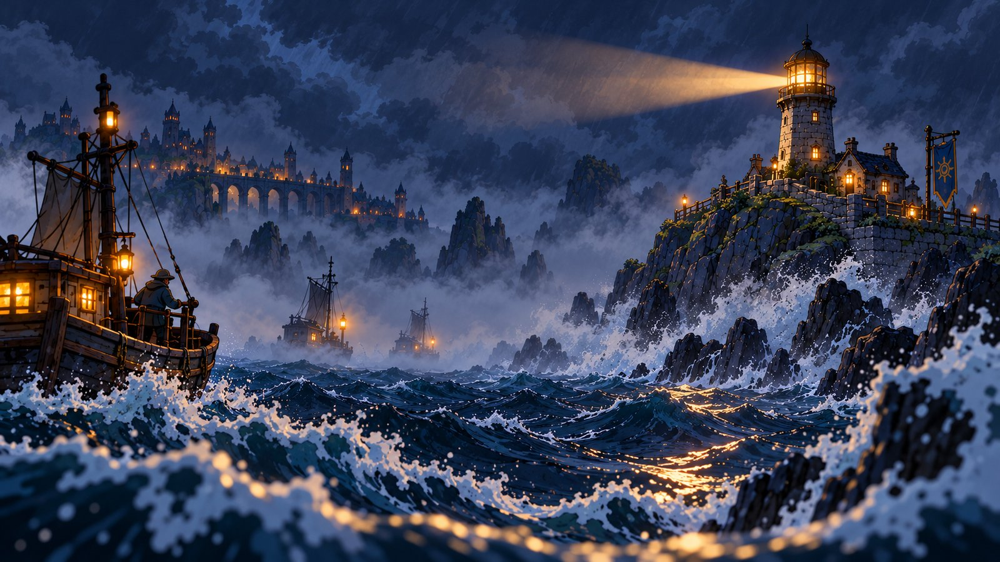
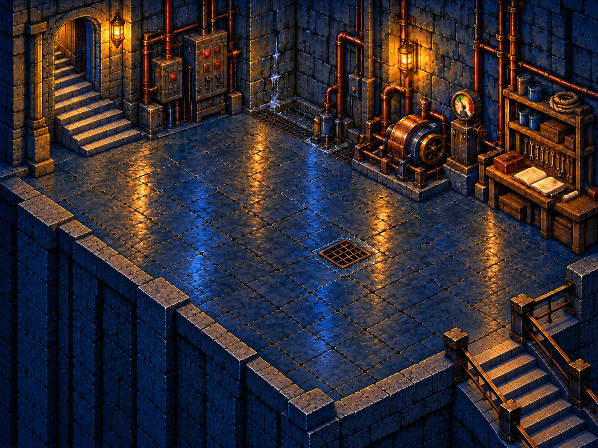
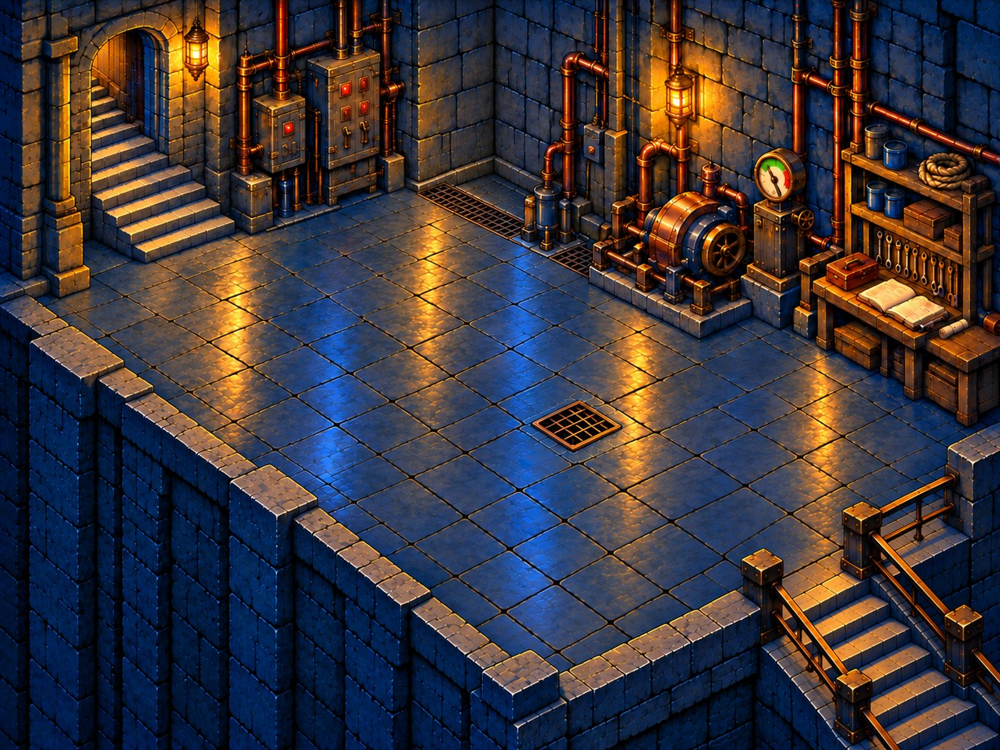
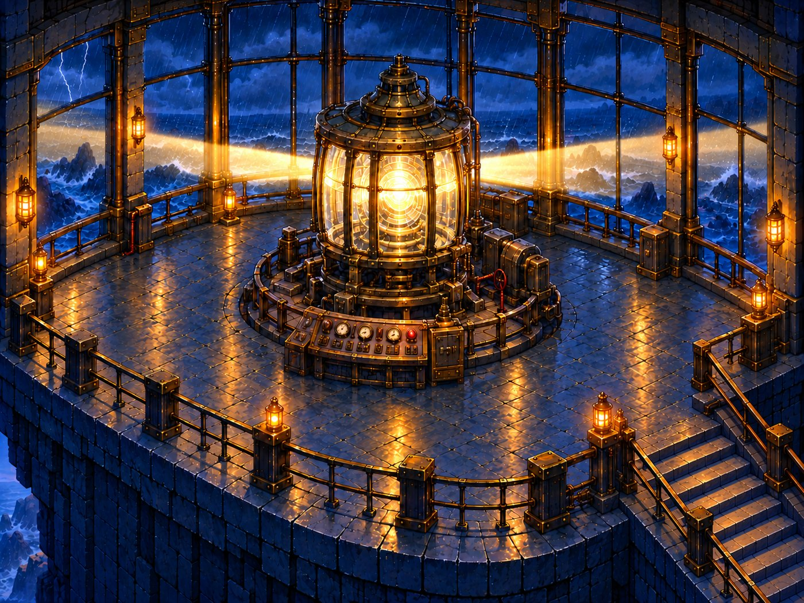

# 遗迹光路 Path of Light

**引擎**：Godot 4.7.2（GDScript）　|　**类型**：2D 俯视角 · 灯塔检修解谜　|　**平台**：Windows / macOS / Linux　|　**渲染**：OpenGL 兼容模式（低配友好）



## 游戏简介

暴风雨深夜，海上灯塔的管道破裂、齿轮卡死、线路受潮，顶部主灯骤然熄灭，归航的渔船在怒浪与暗礁之间失去了方向。

老守护者岑伯把维修手册和工具托付给少年。少年推开沉重的铁门，从被海水侵蚀的地基层开始，逐层检修灯塔的七道系统——地基、管道、电路、齿轮、镜片、焦距、主灯，直到灯室重新亮起，金色光束再次扫过海面，引船只平安归港。

《遗迹光路》是一款以"动手检修"为核心玩法的 2D 叙事解谜游戏：没有战斗，没有失败惩罚，玩家在精细手绘的灯塔内部完成一个个真实感的维修小任务，体验从废墟到复明的完整修复过程。

## 游戏特色

- **完整的叙事闭环**：标题界面 → 开场动画 → 七层检修 → 结尾动画，含存档、暂停与返回标题流程。
- **22 个手工设计的检修任务**：零件拖拽、按序检查、旋钮对准、双参数校准四种交互方式，对应真实维修逻辑。
- **故障态 / 修复态双场景**：每层完成后整层背景由故障态切换为修复态，配合自定义着色器呈现修复过渡。
- **三级徽章评价**：根据本层失误次数结算"未取得 / 已取得 / 发光"徽章，零失误才能拿到发光徽章，鼓励反复挑战。
- **拆装模式**：全楼 102 件透明独立物件均可取下、拖动、复位，可自由检查灯塔内部构造。
- **原创音频**：45 个原创 UI、脚步、环境与维修音效，搭配凯尔特风格开场与结尾配乐。
- **低配置友好**：采用 Godot GL Compatibility 渲染器，老旧电脑也能流畅运行。

## 截图展示

第一层地基层——故障态（漏水、积水、警报）：



第一层地基层——修复态（漏水停止、灯光转暖）：



第七层主灯室——主灯重新点亮，光束穿透雨幕：



## 玩法说明

### 操作方式

| 按键 | 作用 |
| --- | --- |
| 方向键 / WASD | 在楼层内移动 |
| E / 空格 | 靠近检修点时打开维修面板；在楼梯口上下楼 |
| 鼠标 | 在维修面板中拖拽、点选、旋钮和参数调节 |
| Esc | 暂停游戏、关闭维修面板、跳过过场视频 |
| M | 进入 / 退出拆装模式 |
| Tab（拆装模式） | 切换当前可操作的物件 |
| 左键（拆装模式） | 拖动 / 取下物件 |
| 右键或回车（拆装模式） | 复位当前物件 |
| R（拆装模式） | 全部物件复位 |

### 七层检修任务（共 22 个）

第一至六层每层 3 个任务，第七层 4 个。全部完成后本层才会切换为修复态并开放上层楼梯。

| 楼层 | 任务数 | 检修内容 |
| --- | --- | --- |
| 第一层 · 地基 | 3 | 清盐霜、空鼓检查、承压测试 |
| 第二层 · 管道 | 3 | 定位漏点、拼接管段、泵压测试 |
| 第三层 · 电路 | 3 | 排查受潮、恢复回路、电压测试 |
| 第四层 · 齿轮 | 3 | 卡滞诊断、更换齿轮、空载调速 |
| 第五层 · 镜片 | 3 | 擦除盐雾、裂损检查、安装镜片 |
| 第六层 · 焦距 | 3 | 光源定位、镜组校准、温度测试 |
| 第七层 · 主灯 | 4 | 系统回传、闪灯校验、航道方位、启动 |

### 徽章评价

| 状态 | 判定条件 |
| --- | --- |
| 未取得 | 本层任务尚未全部完成 |
| 已取得 | 本层任务完成，但出现过一次或更多操作失误 |
| 发光 | 本层所有任务均无失误完成 |

装错零件、次序错误会记录一次失误；参数未进入安全区时可以继续调整，不扣分。失误不会阻断通关，维修面板中停顿 7 秒会出现一句温和的操作提示。

### 楼层与进度

- 上层楼梯第一至六层位于画面左侧，下层楼梯第二至七层位于画面右下，均按原画实际位置布置。
- 完成本层全部任务后才能走上楼梯进入下一层，顶部七枚徽章只展示进度，不能直接跳层。
- 从第二层起可以沿下层楼梯返回已走过的楼层。
- 移动范围按主角脚底轮廓与设备占地多边形判定，无法穿过护栏和设备，并带有前后景遮挡。

### 过场视频

- 新游戏先播放约 58 秒开场视频，按 Esc 或右上角按钮可跳过并直接进入第一层。
- 第七层主灯点亮后播放约 46 秒结尾视频，可跳至末帧，再按 Esc 或"返回标题"回到主菜单。
- 视频以 16:9 居中显示，上下保留黑边，避免画面变形。

## 运行游戏

### 方法一：在 Godot 编辑器中运行（推荐）

1. 前往 [Godot 官网](https://godotengine.org/) 下载 **Godot 4.7.2-stable**（免费开源，解压即用，无需安装）。
2. 启动 Godot，在项目管理器中点击 **导入**。
3. 选择工程目录下的 `project.godot` 文件并打开。
4. 按 **F5** 从标题界面运行完整游戏；打开 `scenes/lighthouse_game.tscn` 后按 **F6** 可单独调试七层玩法场景。
5. 首次打开工程时 Godot 会导入全部资源，需要等待一段时间，属正常现象。

### 方法二：测试包一键启动

双击工程目录中的 `开始测试.cmd` 即可启动，具体测试事项见 `队员测试说明.md`。

### 系统要求

- 操作系统：Windows 10/11、macOS 或 Linux
- 显卡：支持 OpenGL 3.3 / OpenGL ES 3.0（GL Compatibility 渲染器，核显与老旧显卡均可运行）
- 磁盘空间：约 600 MB（含交付参考包与过场视频）

## 项目结构

```text
Godot 工程根目录/
├── project.godot                # 工程配置：启动场景、分辨率、渲染器
├── default_bus_layout.tres      # 音频总线布局
├── 开始测试.cmd                  # 测试队员一键启动脚本
├── 队员测试说明.md
├── scenes/                      # 场景
│   ├── game_shell.tscn          # 启动场景：标题/开场/存档/暂停/结尾
│   ├── lighthouse_game.tscn     # 七层核心玩法场景
│   ├── asset_gallery.tscn       # 素材检查器
│   └── character_animation_preview.tscn  # 角色动画检查场景
├── scripts/                     # GDScript 逻辑（8 个脚本，约 3200 行）
│   ├── game_shell.gd            # 标题流程、存档、过场视频
│   ├── lighthouse_game.gd       # 楼层、移动、碰撞、楼梯、徽章
│   ├── repair_interaction.gd    # 22 个检修任务的操作规则
│   ├── repair_art_overlay.gd    # 维修画面热点与状态显示
│   ├── scene_aligned_character.gd  # 场景角色对齐
│   ├── asset_gallery.gd         # 素材检查器逻辑
│   ├── character_animation_preview.gd
│   └── ui_typography.gd         # UI 文字排版
├── shaders/
│   └── partial_floor_repair.gdshader  # 故障态→修复态过渡
├── assets/
│   ├── ui/                      # 全局界面、检修面板、徽章、手册、立绘、图标
│   ├── audio/                   # 配乐、45 个音效、人声工作样片
│   ├── characters/              # 主角 SpriteFrames（17 个动画状态）
│   ├── cinematic/               # 开场/结尾 .ogv 视频与关键帧
│   ├── levels/                  # 七层场景图、102 件独立物件、图层
│   ├── data/                    # 任务与几何 JSON 配置
│   └── fonts/                   # 中文字体
├── tools/                       # 自动化测试与资源构建脚本
├── docs/                        # 设计文档
└── 交付/                         # 开场/结尾动画参考包与压缩包
```

## 技术栈

- **Godot Engine 4.7.2** + **GDScript**（8 个脚本，共约 3200 行）
- 渲染：GL Compatibility（OpenGL），基准画布 1536 × 1024
- 过场视频：Ogg Theora / Vorbis（`.ogv`，1536 × 864，30 fps）
- 音频：WAV PCM 16-bit 44.1 kHz、MP3
- 数据配置：JSON（任务面板、楼层几何、物件布局）
- 资源管线：Python（Pillow）、PowerShell 构建脚本

## 资源规模

- **场景**：七层共 14 张故障态 / 修复态手绘大图，102 件透明独立物件
- **角色**：17 个动画状态（待机、行走、操作、维修、翻手册、成功、失败等），单帧规格 448 × 704
- **音频**：45 个原创音效 + 开场 / 结尾两首配乐 + 游戏内音乐
- **字体**：HarmonyOS Sans SC、霞鹜文楷 LXGW WenKai、思源宋体（均为可自由使用的中文字体）

## 自动化测试

工程 `tools/` 目录提供多套自动化检查，可在 Godot 编辑器中直接运行：

| 脚本 | 检查内容 |
| --- | --- |
| `smoke_test_game.gd` | 22 个鼠标操作、移动、路径可达、徽章等级、楼梯锁定与上下楼全流程 |
| `test_dismantle_game.gd` | 102 件独立物件的取下、拖动与复位 |
| `test_cinematic_video.gd` | 开场 / 结尾视频播放、跳过与末帧 |
| `test_polygon_geometry.gd` | 碰撞多边形几何 |
| `verify_completion_systems.gd` | 任务完成与徽章结算系统 |
| `verify_character_walk_frames.gd` | 角色行走帧与脚底对齐 |
| `audit_repair_art.gd` / `audit_independent_components.py` | 维修面板与独立物件资源审计 |

## 当前状态

游戏七层可玩流程已全部打通，正在进行上线前的细节打磨。工程内不包含个人存档与 Godot 自动生成的 `.godot` 缓存目录，克隆仓库后用 Godot 打开即可自动重建。
